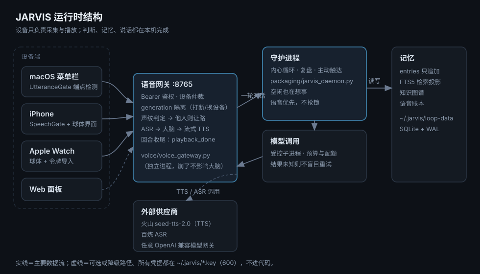

# JARVIS

[](https://github.com/sober-hey/jarvis-agent/actions/workflows/checks.yml)

> ！！！兄弟们姐妹们，copy 之后开发新的东西一定要 pull request 啊！！！！我们共同开发一个更好的 jarvis

一个常驻在自己电脑上的个人智能体：语音是主入口，长期记忆是底，模型负责思考与说话。
不是聊天框套壳——它有自己的心跳、自己的账本、自己的作息。

**当前状态：v1.0 开发中，可在 macOS 上日常自用；未做 Linux 生产验收。**



## 它是什么

- **语音进出**：Mac 菜单栏、iPhone、Apple Watch 三个入口。说一句话，它接住、理解、回答，用流式语音回给你。
- **一个持续存在的大脑**：守护进程常驻，空闲时自己在想事、整理记忆、复盘；不是等你说一句才动一下。
- **单一时间线**：没有"会话"概念。所有感知、对话、念头进同一条只追加的账本，每条可追溯。
- **分清谁在说话**：本地声纹模型判断是不是主人在说。别人说话时不插嘴，等你们聊完再问一句要不要继续。
- **记忆与知识图谱**：SQLite 只追加账本 + FTS5 检索 + 知识图谱投影，投影可重建、不回写源。

## 已实现

| 模块 | 能力 | 验证 |
|---|---|---|
| 语音网关 | WebSocket 多设备接入、Bearer 鉴权、设备仲裁、generation 隔离（打断/换设备不串音） | `voice/tests` 213 passed |
| 语音合成 | 火山引擎 `seed-tts-2.0` 双向流式，逐句推流；百炼 CosyVoice 可切换 | 自检首包约 683ms，整句约 1.1s |
| 语音识别 | 百炼 ASR，单次 12 秒上限 + 一次重试 | 端到端实测 |
| 端点检测 | Mac 自适应 `UtteranceGate`（标定底噪、分档静音、观察窗、300ms 预卷）；iOS 固定门限 `SpeechGate` | 16 种说话方式仿真全过 |
| 声纹 | sherpa-onnx CAM++（192 维），本人/他人判定 + 让路逻辑 | 阈值 0.40，三类声音间隔充足 |
| 唤醒与手势 | 离线唤醒词、响指、连拍两次 | 阈值由真实录音回放标定 |
| 客户端 | macOS 菜单栏 App、iPhone 球体界面、Watch 球体、本机 Web 面板 | 可编译、可真机运行 |
| 守护进程 | 内心循环、记忆整理、复盘、主动触达、自省 | `packaging/` 1400+ 用例 |
| 模型接入 | 受控子进程、令牌桶预算、日配额、结果未知门禁（不盲目重试） | 故障注入用例 |
| 记忆 | 只追加账本、FTS5 检索投影、知识图谱、引用追溯 | `tests` 2381 passed |
| 运维 | systemd 单元、备份脚本、健康探针、令牌轮换、CI | 脚本实跑过 |

## 还没做 / 没验证

诚实地列在这里，避免有人以为拿来就能上生产：

- **Linux 生产部署未验收**：systemd 单元与部署说明是草案，只在 macOS 上跑过。
- **24 小时长跑没做**：没有真实长跑证据。
- **回声消除没做**：现在的做法是让回复走与录音同一个音频引擎，靠系统 AEC 顺带处理；效果依赖设备。
- **iOS / Watch 真机装机**：需要自己的 Apple 开发者签名，仓库里没有、也不会有别人的证书。
- **网关没有 TLS**：只有共享 Bearer 令牌，只适合内网或 Tailscale，不要直接暴露公网。
- **单人设计**：没有多用户、没有账号体系、没有云端同步。
- **内核层 K0–K4 是草案**：`src/jarvis/` 里的审批/预算/取消/事件存储尚未全部接线到生产路径。
- **引擎运行环境要自建**：`packaging/runtime/engine-venv` 不随仓库发布，跑 `scripts/build_engine_runtime.sh` 重建（需要 uv 与上游 agent engine）。
- **3D 形象子项目未包含**：体积大且含商业第三方 SDK，不在本仓库。

## 运行前提

| 依赖 | 说明 |
|---|---|
| Python 3.12 | 主程序与测试（`uv sync --frozen`） |
| 引擎运行环境 `packaging/runtime/engine-venv` | 一个独立的 Python 3.14 venv，里面装上游 agent engine。模型调用、内心循环、`packaging/` 的大部分用例都靠它。**本仓库不包含它**（体积大且是第三方代码），要自己建；构建记录见 `packaging/runtime/BUILD_MANIFEST.json` |
| 上游 agent engine | MIT 许可的 Hermes Agent（Nous Research）。引擎 venv 里装的就是它，需自行获取 |
| Xcode 16+ | 只在编客户端时需要 |
| ffmpeg | 语音合成后处理需要 |

没有引擎运行环境时：`tests/` 与 `voice/tests/` 大部分能跑，`packaging/` 里依赖真实引擎的用例会失败或跳过。
**一键构建**（需要 uv 与上游 agent engine）：

```sh
scripts/build_engine_runtime.sh          # 建到 packaging/runtime/engine-venv
scripts/build_engine_runtime.sh --check  # 只检查现有环境
```

脚本做的事：找 Python 3.14 → `venv --without-pip --copies` → 按上游 `uv.lock` 装 66 个包 →
补装产品侧依赖（numpy / pandas / sherpa-onnx / websockets / ddgs）→ `uv pip check` →
导入冒烟 → 写 `packaging/runtime/BUILD_RECORD.json`（本机构建记录，不入库）。

## 快速开始（macOS）

```sh
# 1. 依赖
uv sync --frozen            # Python 3.12，仓库内 .venv

# 2. 配置（不写进代码，全部走环境变量或 ~/.jarvis/ 下的文件）
mkdir -p ~/.jarvis
cat > ~/.jarvis/config.json <<'JSON'
{
  "model": "你的模型名",
  "provider": "custom",
  "base_url": "https://你的模型网关/v1",
  "api_mode": "chat",
  "context_length": 128000,
  "reasoning_effort": "medium"
}
JSON
printf '%s' '你的模型 API Key' > ~/.jarvis/api.key && chmod 600 ~/.jarvis/api.key

# 3. 跑测试，确认环境没问题
mkdir -p ~/.tmp-pytest
TMPDIR=$HOME/.tmp-pytest PYTHONPATH=packaging .venv/bin/python3 -m pytest packaging/ -q
PYTHONPATH=voice:packaging .venv/bin/python3 -m pytest voice/tests -q

# 4. 起网关（设备接入，默认 8765）
PYTHONPATH=voice:packaging .venv/bin/python3 voice/voice_gateway.py \
  --token-file ~/.jarvis/voice-gateway.token \
  --config ~/.jarvis/config.json \
  --brain-key ~/.jarvis/api.key \
  --data-dir ~/.jarvis/loop-data \
  --log ~/.jarvis/voice-gateway.log

# 5. 起守护进程（内心循环）
PYTHONPATH=packaging .venv/bin/python3 packaging/jarvis_daemon.py \
  --data-root ~/.jarvis/loop-data \
  --config ~/.jarvis/config.json \
  --key-file ~/.jarvis/api.key
```

首次使用要建令牌文件（44 字符随机串，权限 600），设备端填同一个值。

### 语音相关的环境变量

| 变量 | 用途 | 不设会怎样 |
|---|---|---|
| `JARVIS_IMESSAGE_ACCOUNT` | iMessage 发送方（Apple ID 的地址形式） | 入站读不到消息 |
| `JARVIS_IMESSAGE_SIR` | 主人的号码（+86…） | 同上 |
| `JARVIS_IM_SEND_SCRIPT` | 发 iMessage 的脚本路径 | 出站降级到 web/邮件 |
| `JARVIS_REPO_ROOT` / `JARVIS_HEALTH_DB` | 仓库根与健康库路径 | 用默认路径 |

密钥一律放 `~/.jarvis/*.key`（600）或环境变量，**不要写进代码**。

## 仓库里有什么、没有什么

**在**：全部运行时代码（`voice/`、`packaging/`、`src/`）、测试、契约、部署单元、
架构决策（ADR）、设计稿、调研、验收与缺口报告、客户端工程、视觉参考素材。

**不在**（体积、许可或个人数据原因）：

| 内容 | 原因 | 怎么补 |
|---|---|---|
| `packaging/runtime/engine-venv` | 独立 Python 3.14 环境，几百 MB | 按 `packaging/runtime/BUILD_MANIFEST.json` 自建 |
| 上游 agent engine（Hermes Agent，MIT） | 第三方代码，246 MB | 自行获取后装进引擎 venv |
| 3D 形象子项目 | 3.2 GB，含商业第三方 SDK（KeenTools） | 不公开；`assets/avatar/` 有外观参考图 |
| 构建日志、真机验收证据 | 含设备 ID、签名身份等个人信息 | 不入库；需要时在本地复跑 |
| 语音样本、健康与消息数据 | 个人数据 | 一律不入库 |

## 目录结构

```
voice/          语音子系统：网关、ASR/TTS 适配器、声纹、账本
packaging/      Python 运行时：守护进程、模型启动器、Web 面板、其余适配器
src/jarvis/     内核层 K0–K4 草案（审批、预算、取消、事件存储）
tests/          内核层与契约测试
apps/           设备端：mac / ios / watchos / web
contracts/      数据与领域契约（DRAFT）
deploy/         systemd 单元与部署说明
docs/           文档（索引见 docs/README.md；框架导读见 docs/FRAMEWORK.md）
scripts/        运维与生成脚本
```

想读代码，从 [`docs/FRAMEWORK.md`](docs/FRAMEWORK.md) 开始：分层、四个入口、加功能放哪、测试怎么跑。

## 测试

先把临时目录建好（**必须**）：数据根校验要求父目录属于当前用户且非共享，
所以测试不用系统 `/tmp`，而用 home 下的私有目录。不建这个目录，用例会报
`No such file or directory: ~/.tmp-pytest/jarvis-run-...`。

```sh
mkdir -p ~/.tmp-pytest

# 内核层与契约（快，约 40 秒）
TMPDIR=$HOME/.tmp-pytest PYTHONPATH=src:packaging:. .venv/bin/python3 -m pytest tests -q

# 运行时全量（约 20 分钟，别并行跑两份）
TMPDIR=$HOME/.tmp-pytest PYTHONPATH=packaging .venv/bin/python3 -m pytest packaging/ -q

# 语音子系统（快）
PYTHONPATH=voice:packaging .venv/bin/python3 -m pytest voice/tests -q
```

## 设计约束

1. **单一时间线**：所有对话进同一条记忆线，不搞会话隔离。
2. **说话由模型生成**：除两条系统级提示（让路追问、忙碌回执）外不写死台词。
3. **语音优先**：后台思考不得阻塞语音链路。
4. **凭据不进代码**：密钥只在 `~/.jarvis/*.key` 或环境变量里。
5. **不许假装完成**：登记表不是完成表；没有测试与证据的功能一律算未完成。

## 关于这个项目

本项目的代码全部由 **Opus 5.5 高思考模式**生成。

项目规模较大，累计支出约 **5000 元**。个人经济上已经承担不住继续投入，所以开源出来——
希望有兴趣的人一起把功能做全、把坑填平。issue、PR、吐槽都欢迎。

## 许可

MIT，见 [LICENSE](LICENSE)。

## 免责

这是一个个人助理项目，会读写你本机的消息、健康、位置等数据。默认设计是单人自用、
只在内网/Tailscale 可达。把它暴露到公网之前，请自己补上 TLS、鉴权和访问控制。
